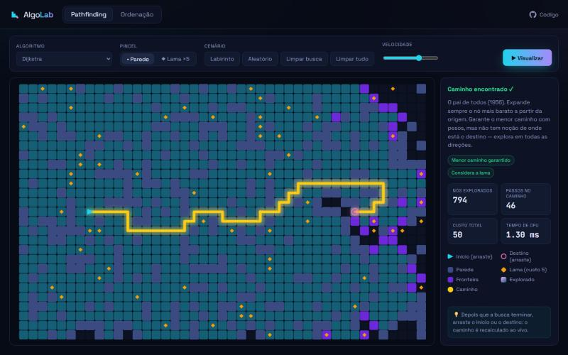
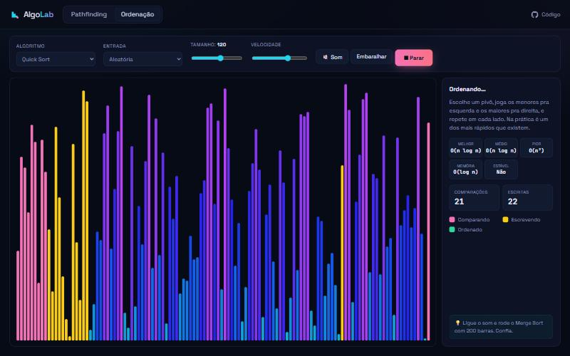

<div align="center">

# 🧭 Algo Lab

**Veja algoritmos pensando em tempo real.**
Desenhe paredes, gere labirintos, jogue lama no caminho e assista A*, Dijkstra, BFS e DFS disputando quem chega primeiro. Na outra aba, seis algoritmos de ordenação brigando com até 200 barras — com som.

[](https://github.com/thiagoalves0707/algo-lab/actions/workflows/deploy.yml)


### [▶ Abrir a demo ao vivo](https://thiagoalves0707.github.io/algo-lab/)



</div>

---

## ✨ O que dá pra fazer

### 🗺️ Pathfinding
| | |
|---|---|
| **5 algoritmos** | A\*, Dijkstra, Busca Gulosa, BFS e DFS — cada um com explicação e selos de "garante o menor caminho?" e "considera pesos?" |
| **Desenhe livremente** | Clique e arraste pra criar paredes ou **lama** (custa 5× pra atravessar) |
| **Labirintos** | Gerador por *recursive backtracker* animado, cavando célula por célula |
| **Recalcular ao vivo** | Depois da busca, arraste o início ou o destino e o caminho se refaz instantaneamente |
| **Métricas reais** | Nós explorados, passos, custo total e o **tempo de CPU** do algoritmo (medido sem a animação) |

### 📊 Ordenação



- **6 algoritmos:** Quick, Merge, Heap, Insertion, Selection e Bubble
- **4 tipos de entrada:** aleatória, quase ordenada, invertida e poucos valores únicos — ótimo pra ver o Insertion Sort voar em dados quase ordenados e o Quick Sort sofrer com repetidos
- **Contadores ao vivo** de comparações e escritas + tabela de complexidade (melhor/médio/pior/memória/estável)
- **🔊 Som da ordenação:** cada barra vira uma nota musical via Web Audio API

---

## 🧠 Como funciona por dentro

A ideia central é **separar o algoritmo da animação** usando *generators* do JavaScript.

Cada algoritmo é uma `function*` que parece código de livro — ele só dá `yield` quando acontece algo interessante:

```ts
function* bfs(g: Grid, start: number, end: number) {
  const queue = [start];
  for (let head = 0; head < queue.length; head++) {
    const cur = queue[head];
    yield { type: 'visit', cell: cur };        // ← "olha, explorei esse nó"
    if (cur === end) { /* ... */ return; }
    for (const nb of neighbors(g, cur)) { /* ... */ }
  }
}
```

Quem decide o ritmo é o [`Animator`](src/core/animator.ts): a cada frame ele puxa N passos do generator conforme a velocidade escolhida. Isso dá três coisas de graça:

1. **Os algoritmos não sabem que existe canvas** — dá pra testar e reaproveitar em qualquer lugar.
2. **Pausar, acelerar e cancelar** viram só "parar de chamar `.next()`".
3. **Modo instantâneo:** o mesmo generator roda até o fim num loop `for...of`, que é o que faz o "recalcular ao vivo" funcionar.

Outro detalhe legal: **Dijkstra, A\* e Gulosa são o mesmo código.** Só muda a função de prioridade passada pro motor [`bestFirst`](src/pathfinding/algorithms.ts):

| Algoritmo | Prioridade de cada nó |
|---|---|
| Dijkstra | `custo até aqui` |
| A\* | `custo até aqui + distância estimada até o fim` |
| Gulosa | `distância estimada até o fim` |

Outras decisões de performance:
- Grade em **typed arrays achatados** (`Uint8Array`), índice `linha * cols + coluna` — nada de matriz de objetos.
- **Min-heap próprio** com arrays paralelos ([`heap.ts`](src/core/heap.ts)) — O(log n) por operação e zero alocação de objetos.
- O canvas **só redesenha quando algo muda** ou ainda tem célula animando.

---

## 🚀 Rodando localmente

```bash
git clone https://github.com/thiagoalves0707/algo-lab.git
cd algo-lab
npm install
npm run dev
```

Atalho: **barra de espaço** roda/para a visualização.

## 📁 Estrutura

```
src/
├── core/
│   ├── animator.ts      # executa generators no ritmo da animação
│   ├── canvas.ts        # helpers de desenho (retina, cores, easing)
│   └── heap.ts          # fila de prioridade (min-heap)
├── pathfinding/
│   ├── algorithms.ts    # A*, Dijkstra, Gulosa, BFS, DFS
│   ├── grid.ts          # grade em typed arrays
│   ├── maze.ts          # gerador de labirinto
│   └── view.ts          # canvas + mouse/toque
├── sorting/
│   ├── algorithms.ts    # Quick, Merge, Heap, Insertion, Selection, Bubble
│   ├── sound.ts         # Web Audio
│   └── view.ts
└── main.ts
```

---

<div align="center">

Feito por **[Thiago Alves](https://github.com/thiagoalves0707)** · Se curtiu, deixa uma ⭐

</div>
